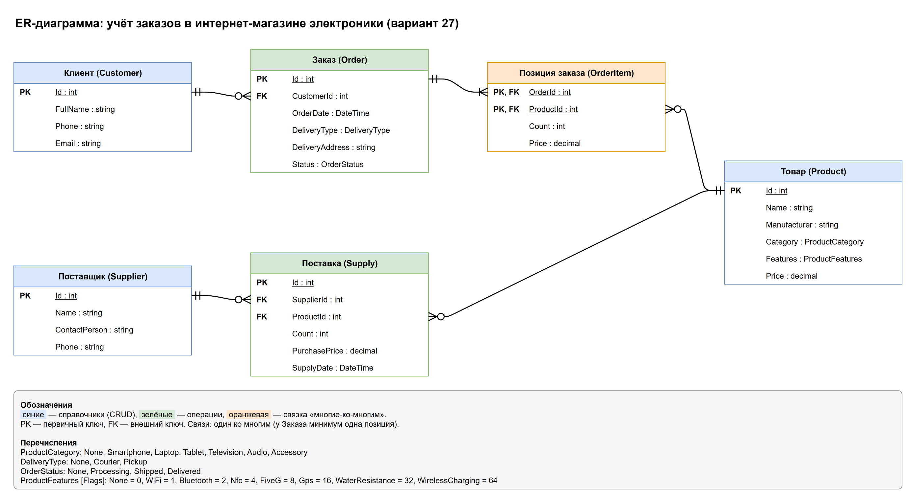

# ER-диаграмма: учёт заказов в интернет-магазине электроники (вариант 27)

Исходник диаграммы — [ER-diagram.drawio](ER-diagram.drawio), открывается в draw.io.

## Сущности

| Сущность | Тип | Назначение |
|---|---|---|
| Товар (`Product`) | справочник | каталог товаров с характеристиками и ценами |
| Клиент (`Customer`) | справочник | покупатели, оформляющие заказы |
| Поставщик (`Supplier`) | справочник | контрагенты, поставляющие товар на склад |
| Заказ (`Order`) | операция (создание, просмотр, удаление) | заказ клиента со способом получения и статусом |
| Позиция заказа (`OrderItem`) | связка | связь «многие-ко-многим» между заказами и товарами |
| Поставка (`Supply`) | операция (создание, просмотр) | поступление товара на склад от поставщика |

Справочники поддерживают полный набор CRUD. Дата операции и статус нового заказа («в обработке») проставляются автоматически.

Остаток товара на складе = сумма количеств по поставкам − сумма количеств по позициям заказов.

## Перечисления

- `ProductCategory` — категория товара: смартфоны, ноутбуки, планшеты, телевизоры, аудиотехника, аксессуары.
- `DeliveryType` — способ получения заказа: курьерская доставка или самовывоз.
- `OrderStatus` — статус заказа: в обработке, отправлен, доставлен.
- `ProductFeatures` (`[Flags]`) — набор характеристик товара: Wi-Fi, Bluetooth, NFC, 5G, GPS, влагозащита, беспроводная зарядка.
